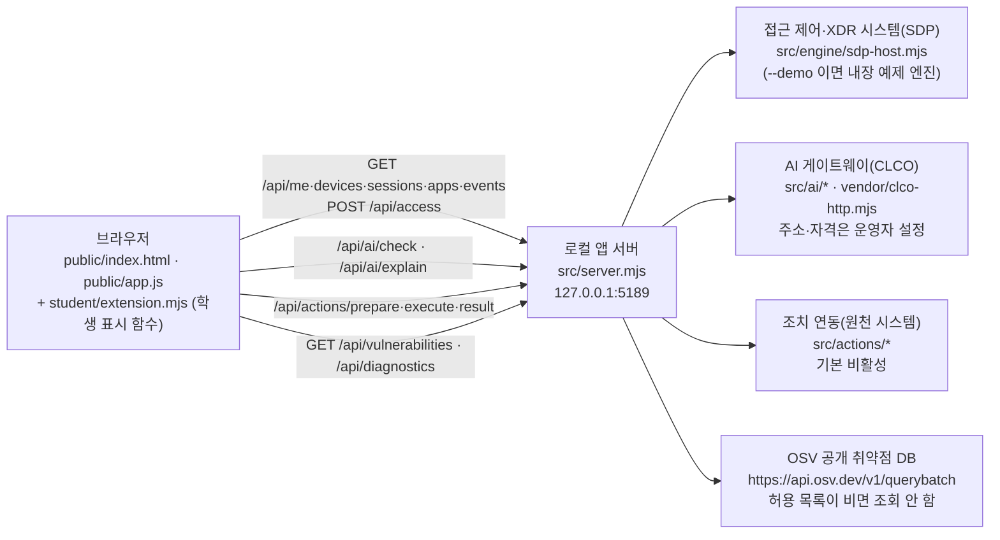

# 케셰브 학생 실행 설명서와 시스템 구성도

이 문서는 학생이 직접 작성했습니다. 제공 문서(`README.md`의 제공 부분, `docs/STUDENT_LAUNCH_GUIDE.md`, `docs/CONNECTION_TROUBLESHOOT.md` 등)는 고치지 않았고, 이 문서는 그 위에 **이 프로젝트에서 실제로 확인한 것**과 **확인하지 못한 것**을 나눠 적습니다.

표기 약속:

- **화면 확인**: 내 PC에서 앱을 켜고 브라우저 화면으로 직접 본 것
- **모의 점검**: 가짜 DOM과 모의 입력으로 `student/extension.mjs` 함수를 node에서 실행해 본 것(실제 서버·연동 시스템 아님)
- **코드만 읽음**: 실행하지 않고 코드·제공 문서를 읽어 적은 것
- **미확인**: 실행하지 못했거나 결과를 받지 못한 것. 성공으로 보지 않습니다.

## 1. 목적과 기능

케셰브는 회사 직원이 자기 로그인·기기·세션 상태, 업무 앱 접속 판정, 접속·XDR 기록, AI 연결 상태와 AI 사건 설명, 보안 조치 상태, 설치 패키지의 알려진 취약점 조회 결과를 확인하는 보안 Agent 앱입니다. 학생은 13~20단계 동안 `on-client/student/extension.mjs`의 표시 함수를 구현했습니다.

## 2. 필요 프로그램과 실제로 확인한 버전

| 프로그램 | 이 PC에서 확인한 버전 | 수업 기준 | 비고 |
|---|---|---|---|
| Windows | Windows 11 Pro 10.0.26200 | Windows | 화면 확인에 사용 |
| Windows PowerShell | 5.1 | - | 실행 명령 입력 |
| Node.js | v24.22.1 (`node --version`) | 24.19.0 (`package.json`의 `engines`) | **기준 버전과 다릅니다.** 24.19.0에서는 실행해 보지 않았습니다(미확인). 제공 문서상 지원 범위는 22~24입니다. |
| npm | 11.19.1 (`npm.cmd --version`) | - | 외부 npm 의존성이 없어 `npm install`은 필요 없습니다. |
| Git | 2.55.0.windows.5 | - | 커밋·push |
| 브라우저 | 데스크톱 브라우저(버전 기록 안 함) | - | `http://127.0.0.1:5189/` 접속 |

- `package.json`에 `dependencies`가 없고, 앱 폴더에 `package-lock.json`도 없습니다. 따라서 설치 단계는 없습니다(코드만 읽음).
- 20단계 패키지 조회가 읽는 `package-lock.json`은 이 앱의 것이 아니라 `ON_PROJECT_DIRECTORY`로 운영자가 지정한 조회 대상 프로젝트의 것입니다. 이 PC에서는 지정되지 않아 `not_configured`가 나옵니다(화면 확인).

## 3. 폴더 구조

```text
케셰브-방어전/                     ← Git 최상위(프로젝트 폴더). 커밋·push는 여기서
└─ on-client/                      ← 앱 폴더. 실행 명령은 여기서
   ├─ package.json                 ← start / demo / check / package-app 스크립트
   ├─ .env.example                 ← 비밀 없는 설정 견본(ON_PORT=5189 등)
   ├─ src/server.mjs               ← 로컬 앱 서버(제공)
   ├─ src/engine/                  ← SDP 연결 엔진(제공)
   ├─ src/ai/                      ← 앱 내부 AI 연결·설명(제공)
   ├─ src/actions/                 ← 보안 조치 준비·집행·결과 조회(제공)
   ├─ src/vulnerabilities/         ← package-lock 조회·OSV 질의(제공)
   ├─ public/index.html, app.js    ← 제공 화면(학생 함수를 불러 학생 칸에 표시)
   ├─ public/vulnerabilities-view.mjs ← 패키지 조회 응답 검사(normalizeScan, 제공)
   ├─ student/extension.mjs        ← 학생 작성 파일(13~20단계)
   ├─ student/engine-adapter.mjs   ← 엔진 연결 견본(이번 작업에서 고치지 않음)
   ├─ tools/start-alekov.ps1       ← 제공 실행 도구
   └─ docs/STUDENT_RUNBOOK.md      ← 이 문서(학생 작성)
```

## 4. 실행 절차

### 4.1 PowerShell을 여는 위치

1. 파일 탐색기에서 `<프로젝트 폴더>\on-client` 폴더를 엽니다. 실행 코드는 특정 절대경로에 의존하지 않으므로 어느 폴더에 받아도 됩니다(새 폴더 재현은 [STUDENT_RELEASE.md](STUDENT_RELEASE.md) 3장).
2. 주소 표시줄에 `powershell`을 입력하고 Enter를 누릅니다.

Git 최상위(`케셰브-방어전`)에서 `npm.cmd run demo`를 실행하면 `package.json`이 없어 `ENOENT` 오류가 납니다(이 작업 중 실제로 겪음).

### 4.2 실행 명령

| 목적 | 명령(앱 폴더에서) | 확인 상태 |
|---|---|---|
| 예제 자료로 화면 보기 | `npm.cmd run demo` | **화면 확인**(13~20단계 확인에 사용) |
| 기본 실행(연결 없음) | `npm.cmd start` | **화면 확인**(13단계에서 연결 없음 표시 확인) |
| 학생 파일 문법 검사 | `npm.cmd run check` | **실행 확인**(오류 없이 끝남) |
| 제공 실행 도구 | `powershell -NoProfile -ExecutionPolicy Bypass -File .\tools\start-alekov.ps1` | **미확인**: 이번 작업에서는 이 도구로 켜지 않았습니다. 제공 문서(`STUDENT_LAUNCH_GUIDE.md`)의 명령입니다. |

PowerShell 5.1에서 `npm` 대신 `npm.cmd`를 쓰면 실행 정책 오류 없이 실행됩니다.

### 4.3 브라우저 주소와 정상 시작 신호

- 주소: `http://127.0.0.1:5189/` (포트는 `ON_PORT` 환경변수, 기본 5189. 서버는 `127.0.0.1`에서만 받습니다 — `src/server.mjs`)
- 정상 시작 신호(PowerShell 창, `src/server.mjs`의 출력):
  - `npm.cmd run demo` → `케셰브 예제: http://127.0.0.1:5189`
  - `npm.cmd start` → `케셰브 연결 확인: http://127.0.0.1:5189`
- 브라우저에서 위쪽에 「케셰브」 제목, 왼쪽 메뉴에 「보호 현황」 「업무 앱」 「보안 기록」이 보이면 화면이 열린 것입니다(화면 확인). 메뉴는 위·아래 방향키로도 이동할 수 있습니다.
- 서버가 켜졌다는 신호는 로컬 서버가 응답한다는 뜻일 뿐, 연동 시스템이나 AI 연결 성공이 아닙니다. 「예제 자료」·「연결 없음」 표시는 실제 연결이 아닙니다.

### 4.4 종료와 재실행

1. **종료**: 서버를 켠 PowerShell 창에서 `Ctrl+C`를 누릅니다.
2. **재실행**: 같은 앱 폴더에서 4.2의 명령을 다시 실행합니다.
3. **학생 코드를 고친 뒤**: 브라우저에서 **F5**(새로고침)를 누릅니다. 학생 모듈은 페이지를 열 때 한 번만 불러오므로 화면의 「다시 불러오기」 버튼은 자료만 다시 받고 고친 코드는 반영하지 않습니다(화면 확인).
4. 포트 5189를 다른 프로그램이 쓰면 그 프로그램은 두고 포트를 바꿉니다: `$env:ON_PORT = '5190'; npm.cmd run demo` 후 `http://127.0.0.1:5190/` (코드만 읽음, 미확인).

## 5. 시스템 구성도

### 5.1 Mermaid



### 5.2 같은 내용을 글로

```text
[브라우저]  public/app.js (제공) ──학생 칸 그리기──> student/extension.mjs (학생)
    │  HTTP (127.0.0.1:5189 만)
    ▼
[로컬 앱 서버]  src/server.mjs
    ├─ /api/me, /api/devices, /api/sessions, /api/apps, /api/events, /api/access
    │      ──> [접근 제어·XDR 시스템(SDP)]  src/engine/  (--demo: 예제 엔진 / 기본: 연결 없음)
    ├─ /api/ai/check, /api/ai/explain, /api/ai/connect/
    │      ──> [AI 게이트웨이(CLCO)]  src/ai/, vendor/clco-http.mjs
    ├─ /api/actions/prepare, /api/actions/execute, /api/actions/result
    │      ──> [조치 연동 원천 시스템]  src/actions/  (설정 없으면 ACTION_UNSUPPORTED)
    ├─ /api/vulnerabilities
    │      ──> [OSV]  https://api.osv.dev/v1/querybatch  (승인된 공개 패키지만)
    └─ /api/diagnostics  (도움정보, 비밀값 없음)
```

학생 코드는 서버에 요청을 보내지 않습니다. `public/app.js`가 요청·검사·늦은 응답 차단을 하고, 그 결과 사본을 학생 함수에 넘기면 학생 함수는 DOM 요소를 만들어 돌려줄 뿐입니다(코드만 읽음).

비밀 설정(AI 앱 자격, SDP 인증서·개인키, native 설정)은 프로젝트·Git 밖에 두며 이 문서에 적지 않습니다. `.env.example`에는 비밀 없는 값만 있습니다.

## 6. 제공 코드와 학생 작성 부분의 경계

| 구분 | 파일·함수 | 하는 일 |
|---|---|---|
| 제공 | `src/server.mjs`, `src/**` | API 제공, 연동 시스템·AI·OSV 호출, 응답 정리 |
| 제공 | `public/app.js` | 요청·취소·세대 번호로 늦은 응답 차단, 응답 형식 검사(`validExplanation`, `safeActionData`, `normalizeScan` 등), 학생 함수 호출 |
| 제공 | `public/index.html` | 버튼(「다시 불러오기」, 「AI 연결 점검」, 「설치 패키지 조회」, 「패키지 조회 취소」, 「AI 설명 취소」, 「대상과 조치를 확인했으며 집행합니다」, 「원천 결과만 재조회」, 「조치 화면 취소」 등) |
| 학생 | `student/extension.mjs` · `createStudentView()` | 아래 8개 표시 함수를 돌려줌 |

## 7. 학생이 구현한 함수와 확인 결과

| 단계 | 함수 | 표시 내용 | 확인 상태 |
|---|---|---|---|
| 13 | `renderIdentity` | 내 계정·기기·세션, 불러오는 중·실패·확인 불가 | 화면 확인(예제·연결 없음), 모의 점검 |
| 14 | `renderDecision` | 판정 allow/deny/challenge/unknown, 이유, 확인 시각 | 화면 확인(예제), 모의 점검 |
| 15 | `renderEvents` | 기록 목록·필터 3개·상세(`data-student-event-id`, `data-student-event-detail`) | 화면 확인(예제), 모의 점검 |
| 16 | `renderStatus` | 알림·등록 기기·현재 세션·도움정보 복사 | 화면 확인(예제), 모의 점검 |
| 17 | `renderAiConnection` | AI 연결 점검 상태·오류 분류 | 화면 확인: `ON_AI_PROVISIONING_PENDING` 오류 표시만. 연결 성공은 **미확인** |
| 18 | `renderExplanation` | 근거·규칙·확인 불가 상태·제안, `data-student-explanation-event` | 화면 확인: 실패 표시만. 성공 설명은 모의 점검만, 실제는 **미확인** |
| 19 | `renderAction` | 조치 상태 11가지, 효과 관측 조건, `data-student-action-event`·`data-student-action-request` | 화면 확인: idle만. 나머지 상태는 모의 점검만, 실제 집행은 **미확인** |
| 20 | `renderVulnerabilities` | 전체 조회 상태·lock 정보·패키지 행(`data-student-package-name`·`data-student-package-version`) | 화면 확인: `not_configured`와 재조회. 패키지 행·취약점 표시는 모의 점검만, OSV 실제 조회는 **미확인** |

## 8. 오류별 확인 순서

| 증상·코드 | 어디서 보이나 | 확인 순서 | 근거 코드 |
|---|---|---|---|
| `npm` 실행 시 `ENOENT ... package.json` | PowerShell | 1) 현재 폴더가 `on-client`인지 확인 2) 아니면 `cd on-client` 뒤 다시 실행 | npm 동작 |
| 서버가 시작 신호를 출력하지 않고 `INVALID_PORT` | PowerShell | `ON_PORT`가 1024~65535 정수인지 확인 | `src/server.mjs` |
| 학생 칸에 `student/extension.mjs를 불러오지 못했습니다` | 브라우저 | 1) `npm.cmd run check`로 문법 확인 2) 고친 뒤 F5 | `public/app.js` |
| 고쳤는데 화면이 그대로 | 브라우저 | F5로 새로고침(「다시 불러오기」는 코드 반영 안 함) | `public/app.js` |
| 「연결 모드: 연결 없음」 | 학생 칸 | 정상(기본 실행은 연결 없음). 예제는 `npm.cmd run demo` | `src/server.mjs` |
| `CONTRACT_MISMATCH` → 「확인 불가」 | 학생 칸 | 「다시 불러오기」 한 번, 계속되면 도움정보를 담당자에게 | `public/app.js` |
| `ON_AI_PROVISIONING_PENDING` | AI 연결 점검·AI 설명 칸 | 학생 작업 오류 아님. 담당자에게 앱 권한 확인 요청. 유료 요청을 반복하지 않음 | `public/app.js` `AI_MESSAGES` |
| `ON_AI_INVALID_OUTPUT` | AI 설명 칸 | 설명이 기록의 근거와 맞지 않음. 설명을 쓰지 않고 기록은 그대로 사용 | `validExplanation` |
| `ACTION_UNSUPPORTED` / 조치 준비 버튼 없음 | 조치 칸 | 정상(지원 조치 없음, `supportedActions` 빈 배열) | `src/server.mjs`, `public/app.js` |
| 조치 `unknown` | 조치 칸 | 성공·효과 없음으로 판단하지 않고 「원천 결과만 재조회」 | `actionFailure` |
| `PROJECT_NOT_CONFIGURED` (`not_configured`) | 패키지 칸 | 정상(조회 대상 미설정). 학생이 설정을 바꾸지 않음 | `src/vulnerabilities/` |
| 패키지 조회 `CANCELLED`·`TIMEOUT` | 패키지 칸 | 「설치 패키지 조회」를 직접 다시 누름 | `public/app.js` |

더 많은 코드는 제공 문서 `docs/CONNECTION_TROUBLESHOOT.md`의 표를 따릅니다.

## 9. 미확인 기능

| 항목 | 이유 |
|---|---|
| Node.js 24.19.0(수업 기준)에서 실행 | 이 PC는 24.22.1 |
| `tools/start-alekov.ps1` 실행과 그 출력 문구 | 이번 작업에서 사용하지 않음 |
| SDP 실제 연결(`-SdpHostConfig`) | 개인 설정을 받지 않음 |
| 계정 연결·AI 앱 승인·AI 연결 성공 | 운영 측 권한이 준비 중(`ON_AI_PROVISIONING_PENDING`) |
| 실제 AI 설명과 근거 ID 일치 | 위와 같음 |
| 보안 조치 준비·집행·효과 관측 | 연동 시스템 집행기가 연결되지 않음 |
| OSV 실제 조회와 package-lock 버전 대조 | 조회 대상 프로젝트·허용 목록 미설정 |
| 패키지 조회 취소 뒤 늦은 응답 차단 | 응답이 빨라 취소 버튼을 누를 수 없었음(코드만 읽음) |
| `ON_PORT` 변경 실행 | 실행하지 않음 |
| 다른 PC에서 이 문서대로 재현 | 같은 PC의 새 PowerShell 창에서만 재현함(10장) |

## 10. 재현 기록(학생 진술)

새 PowerShell 창에서 4장 절차를 따라 한 결과를 적습니다. 직접 해 보기 전에는 "미확인"으로 둡니다.

| 날짜 | 절차 | 결과 |
|---|---|---|
| 2026-11-25 | 새 PowerShell 창을 4.1 위치에서 열고 `npm.cmd run demo` → 시작 신호 → 브라우저 접속 → `Ctrl+C` → 재실행 | 화면 확인(학생 진술): 시작 신호가 나왔고, `http://127.0.0.1:5189/`에서 「케셰브」 제목과 왼쪽 메뉴가 보였으며, 종료 뒤 재실행해 다시 열림. 같은 PC(Node.js v24.22.1)에서만 확인했고 다른 PC는 미확인 |
